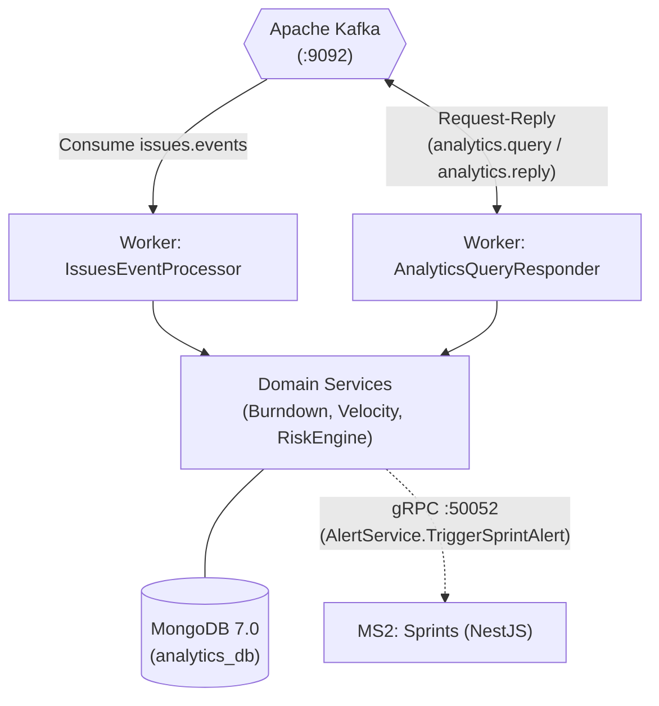

# MS3: Jira Analytics Service (`jira-analytics-dotnet`)

[]()
[]()
[]()
[]()
[]()

Microservicio analítico y motor de métricas de alto rendimiento desarrollado en **C# (.NET 8)** siguiendo los principios de **Clean Architecture**. Funciona como un **Worker asíncrono de Apache Kafka**, procesando flujos de eventos de incidencias, calculando curvas de **Burndown**, velocidad de entrega y alertas predictivas de riesgo, persistiendo en **MongoDB** y notificando anomalías críticas a MS2 (NestJS) mediante **gRPC**.

---

## Rol en la Arquitectura e Interoperabilidad



### Protocolos de Entrada y Salida (Regla de la Pizarra)
* **Ingress (Entrada):**
  * **Apache Kafka Consumer**:
    * Consume eventos de dominio en el tópico `issues.events`.
    * Responde consultas analíticas en el patrón **Kafka Request-Reply** sobre el tópico `analytics.query` devolviendo el resultado en `analytics.reply` preservando la cabecera `kafka_correlationId`.
* **Egress (Salida):**
  * **gRPC Client**: Invoca de manera síncrona el endpoint `TriggerSprintAlert` en `jira-sprints-nestjs:50052` ante detección de riesgos severos o bloqueos.
* **Persistencia:**
  * **MongoDB 7.0** (`analytics_db` en puerto `:27017`) almacenando snapshots de sprints, series temporales de burndown y métricas de velocidad.

---

## Estructura de la Solución (Clean Architecture)

```text
jira-analytics-dotnet/
├── src/
│   ├── JiraAi.Analytics.Contracts/         # DTOs, Envelopes y stubs Protobuf gRPC
│   │   ├── Dtos/                           # AnalyticsQueryDto, AnalyticsReplyDto
│   │   └── Gen/                            # Sprints.cs y SprintsGrpc.cs
│   ├── JiraAi.Analytics.Domain/            # Lógica pura de negocio y modelos
│   │   ├── Models/                         # SprintSnapshotDocument, RiskAssessment
│   │   ├── Repositories/                   # Interfaces de persistencia
│   │   └── Services/                       # BurndownCalculator, VelocityCalculator, RiskEngine
│   ├── JiraAi.Analytics.Infrastructure/    # Adaptadores externos y drivers
│   │   ├── Grpc/                           # AlertClientService (Cliente gRPC a NestJS)
│   │   ├── Messaging/                      # KafkaProducerWrapper y Deserializadores
│   │   └── Repositories/                   # MongoDbContext y SprintSnapshotRepository
│   └── JiraAi.Analytics.Worker/            # BackgroundServices y DI Bootstrap
│       ├── Workers/                        # IssuesEventsWorker, AnalyticsQueryResponderWorker
│       ├── Program.cs                      # Host configuration y logging
│       └── appsettings.json
├── tests/
│   └── JiraAi.Analytics.UnitTests/         # 40+ pruebas unitarias y adversarias
├── .github/workflows/
│   └── ci.yml                              # GitHub Actions workflow (cobertura >= 60%)
├── Dockerfile                              # Multi-stage SDK .NET 8 / ASP.NET runtime
└── jira-analytics-dotnet.sln
```

---

## Configuración y Variables de Entorno

| Variable | Descripción | Valor por Defecto |
| :--- | :--- | :--- |
| `KAFKA_BOOTSTRAP_SERVERS` / `KAFKA_BROKERS` | Servidores Kafka | `localhost:9092` |
| `MONGODB_URI` | Cadena de conexión MongoDB | `mongodb://localhost:27017` |
| `MONGODB_DATABASE` | Nombre de la base de datos | `analytics_db` |
| `MS2_GRPC_URL` | Endpoint gRPC del servicio Sprints/AlertService | `http://localhost:50052` |

También se pueden usar las claves de configuración .NET `Kafka__BootstrapServers`, `Mongo__ConnectionString`, `Mongo__DatabaseName` y `AlertService__Endpoint`.

---

## Pruebas Automatizadas y Cobertura

El proyecto incluye tests unitarios exhaustivos para los motores de cálculo, algoritmos de burndown, deserialización tolerante a fallos y clientes de mensajería:

```bash
# Restaurar dependencias NuGet
dotnet restore

# Compilar solución
dotnet build -c Release --no-restore

# Ejecutar suite de pruebas con análisis de cobertura
dotnet test --no-build -c Release --collect:"XPlat Code Coverage"
```

### Métrica de Cobertura Verificada
* **Cobertura de Línea:** **76.80%** (supera el umbral mínimo del 60.0%).
* **Pruebas Adversarias:** Validación de división por cero en cálculo de velocidad, arrays de burndown vacíos y timeouts en Kafka.

---

## Despliegue con Docker

El microservicio utiliza una imagen optimizada de ejecución basada en `mcr.microsoft.com/dotnet/aspnet:8.0`:

```bash
# Compilar imagen Docker
docker build -t jira-ai-analytics-service .

# Ejecutar contenedor
docker run -d \
  -e KAFKA_BOOTSTRAP_SERVERS="kafka:9092" \
  -e MONGODB_URI="mongodb://mongo-analytics:27017" \
  -e MONGODB_DATABASE="analytics_db" \
  -e MS2_GRPC_URL="http://sprints-service:50052" \
  jira-ai-analytics-service
```

---

## Licencia

MIT License (c) 2026 Jira AI Team.
